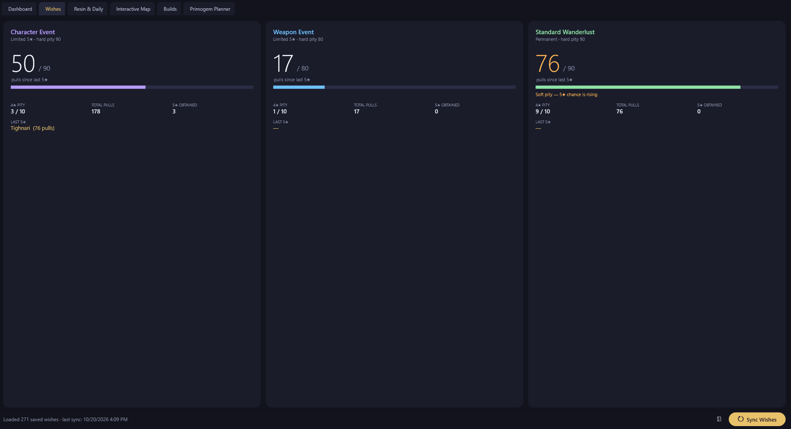
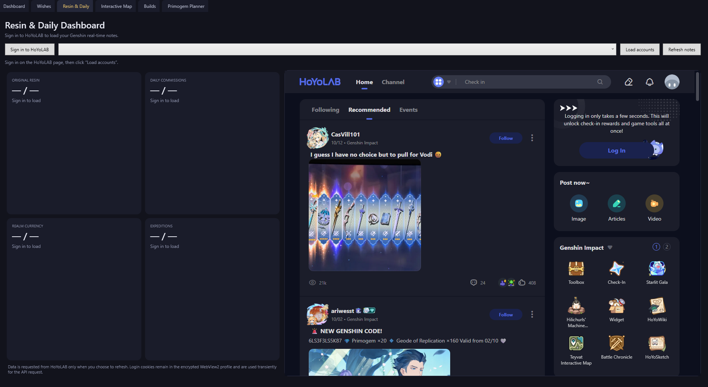
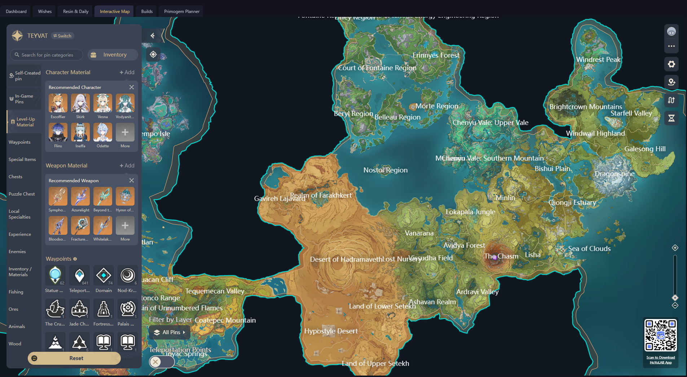

# Genshin Companion

## IMPORTANT: USE THE RELEASE INSTALLER TO GET THE CURRENT VERSION

**DOWNLOAD `GenshinCompanionSetup.exe` FROM THE [LATEST GITHUB RELEASE](https://github.com/greyfoxdevelopment/GFDev-Genshin-Companion/releases/latest). DO NOT DOWNLOAD OR RUN AN EXE FROM THE REPOSITORY'S MAIN FILES — THOSE FILES MAY BE OUTDATED (FOR EXAMPLE, VERSION 1.0.1) AND ARE NOT THE PUBLISHED RELEASE.**

**The release installer is the supported way to install or refresh the app. Once installed from a release, the app checks for updates on launch.**

[Discord](https://discord.gg/WQknYbRKBt)    [Ko-fi](https://ko-fi.com/greyfoxdevelopment)

> DEV NOTE!!!!!!
> CoPilot is listed as a contributor because I asked it a question in VCS about the code and when it answered it pushed the commit to Github without my permission because I had it on "allow All" in VCS so it could answer
> Questions if I needed it to 

## Your wishes, pity, and daily progress at a glance

Keep your Genshin Impact wish history close while you play. Genshin Companion is a free, community-made Windows app with a live wish dashboard, pity counters, official game news, an interactive map, embedded character showcases, and a resin and daily-commission view.

**Want to try it?** Download **`GenshinCompanionSetup.exe`** from the [latest GitHub Release](https://github.com/greyfoxdevelopment/GFDev-Genshin-Companion/releases/latest). Run the installer, accept the license, choose an install location, and it downloads and verifies the latest app for you. An internet connection is required during installation.

> The installer is published with tagged releases. If there is no installer asset on the latest release yet, check back after the next project release.

## Updates and version numbers

Genshin Companion uses a three-part version number: **Major.Minor.Patch** (for example, `2.1.0`).

* **Major** (`[Major].X.X`): a significant release that may include major changes or break compatibility with earlier versions.
* **Minor** (`X.[Minor].X`): adds features or other notable improvements while keeping the same major version.
* **Patch** (`X.X.[Patch]`): a smaller release, typically for bug fixes and refinements.

After installation, the app checks GitHub for an update once when it starts. While it is running, it checks the Genshin Companion release service every five minutes for release information and notifications. When an update is available, the app asks before downloading it. The app downloads the update from GitHub and verifies its SHA-256 checksum before installing it. You can also install or refresh the app manually using the installer on the [latest GitHub Release](https://github.com/greyfoxdevelopment/GFDev-Genshin-Companion/releases/latest).

> ⚠️ **Note on Windows Warnings:** Windows SmartScreen may show a warning for the unsigned installer. Click **"More info"** and **"Run anyway"**, or verify safety via VirusTotal 

## Screenshots

   &nbsp;&nbsp;&nbsp;&nbsp;
  

   &nbsp;&nbsp;&nbsp;&nbsp;
  

## Made for your play session

* **Track your wishes and pity.** View Character Event, Weapon Event, and Standard banner counts, including 4-star and 5-star pity. Sync your history by reading the game's local web cache to retrieve available history from HoYoverse safely.

* **Plan your next character.** Explore an estimated featured-character probability based on primogems, fates, pity, and guarantee state. The planner refreshes wish history from the local game cache the first time it opens, fills pity and guarantee from Character Event history, shows the soft-to-hard-pity curve with a live projection marker, and highlights when your saved wishes cover the worst-case guarantee. View a public character showcase by UID in the embedded Enka.Network page.

* **Keep useful tools together.** View real-time player data in your companion dashboard, tracking your current Resin, commissions, Realm Currency, and expedition progress.

* **See what's new.** The dashboard lists the changes included in the latest app release.

* **Join the community and support the project.** Use the Discord and Ko-fi buttons in the title bar, and see what your support goes toward in the Support tab.

* **Integrated layout features.** Open HoYoLAB's interactive map, and public Enka.Network showcases inside the app. Resize or move the window to fit your play setup, or keep it pinned on top.

## Security and Privacy

Genshin Companion is designed to work without an app account or usage analytics.

* **Local data:** Wish history and app settings are stored on your computer under `%LOCALAPPDATA%\GenshinWishTracker`. Sync diagnostics are also written locally; they contain paths, counts, and API result codes, but not wish links or auth keys.
* **Wish syncing:** The app reads the game's local web cache; it does not interact with or modify the game process or cache. The wish-history link is held in memory while syncing and is not saved to the history, settings, or sync log.
* **HoYoLAB sign-in:** When you choose to sign in, WebView2 stores its browser profile locally. The app uses the sign-in cookies for the HoYoLAB data requests you initiate.
* **Network requests:** The app contacts HoYoverse/HoYoLAB for the features you use, Enka.Network when you look up a public showcase, the Genshin Companion release service for update metadata and notifications, GitHub to check for and download releases, and the official Genshin Impact news site when you open the Game News tab. The Ko-fi widget loads when you open the Support tab. These services may process request information under their own privacy policies.
* **Release notifications and notes:** While running, the app checks `https://gfdcompanion.duckdns.org` for Genshin release metadata every five minutes and listens for live notifications. The latest server-published release title and notes are shown in the dashboard’s “What’s New” section. The service sends only release information (version, notes, and GitHub release page); it does not send application binaries. The app asks before updating, then downloads the executable from GitHub and verifies its SHA-256 checksum before installation.
* **Fallback and availability:** The app checks GitHub for updates only once on launch. If the release service is unreachable at launch, that GitHub check still runs; while the app remains open, it retries the release service every five minutes and catches up on releases missed while disconnected. GitHub remains the source for the update executable and checksum.
* **Release-service metadata:** Connecting exposes network metadata, including your IP address, to the service and potentially its hosting provider. The app does not send an account ID, wish data, or usage analytics to the release service. The service is designed not to retain client connection history or use it for user metrics; hosting-provider logging may still apply.
* **Update integrity:** The installer and in-app updater verify the downloaded app against the SHA-256 checksum published with the GitHub release before installing it. This detects file corruption or mismatch; because the checksum is hosted alongside the release, it is not an independent signature against compromise of the release account.

This is an unofficial community project, not affiliated with or endorsed by HoYoverse. Genshin Impact is a trademark of HoYoverse (COGNOSPHERE).

## Need help?

See [`instructions.txt`](instructions.txt) for installation, first-time setup, feature guides, troubleshooting, and developer/release instructions.

## For developers

The app is a Windows x64 WPF application built with .NET 8. Open `src\GenshinWishTracker.csproj` in Visual Studio or build it with the .NET 8 SDK. See `instructions.txt` for build and release steps.

Released under the [MIT License](LICENSE).
